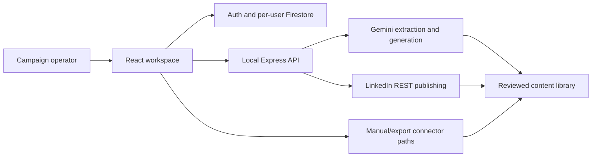

# DemandPilot: Engineering Overview

DemandPilot is a full-stack demand-generation workspace that turns keyword and campaign inputs into reviewed content while keeping AI credentials and publisher tokens on a local Express server rather than in the browser bundle.

## At a glance

| Area | Implementation |
| --- | --- |
| Core stack | React 19, TypeScript, Vite, Tailwind, Express, Firebase Auth and Firestore |
| AI boundary | Server-side Gemini keyword extraction and campaign-content routes with explicit not-configured behavior |
| Publishing | LinkedIn REST connector plus honest manual/export states for other channels |
| Product | Keyword lab, campaign builder, content studio/library, calendar, brand settings, integration hub |
| Verification | Typecheck, 34 tests, production build, server-route and publishing regression coverage |

## Why this project is technically interesting

- **Secrets stay server-side.** Gemini and publisher credentials use non-Vite environment variables and never need to enter the client bundle.
- **Integration status is honest.** Live, manual, access-pending, disconnected, and not-configured states are represented explicitly.
- **The product spans ideation to evidence.** Keywords, generated drafts, review, publishing status, URLs, and content history remain connected.
- **AI failure remains operable.** Manual drafting and safe not-configured responses prevent fabricated provider success.

## System shape

## Guided code tour

1. **`server.js`** — secure AI proxy and publisher routes.
2. **`src/services/aiContentGenerator.ts`** — typed client boundary for server-backed generation.
3. **`src/components/ContentStudio.tsx`** — composition and review workflow.
4. **`src/components/IntegrationHub.tsx`** — capability and connector status.
5. **`src/lib/firebase.ts`** — authenticated client persistence.
6. **`firestore.rules`** — per-user data boundary.
7. **`src/**/*.test.*`** — publishing, server, and workflow regression coverage.

## Verification

The current takeover branch passes:

- TypeScript typecheck;
- 34 Vitest tests;
- Vite production build;
- redacted Git-history and snapshot secret scans;
- Firebase browser-key inspection showing an application restriction and an API allowlist.

The current build reports a large client chunk, which is a real performance-improvement opportunity rather than a correctness failure.

## For coding agents

1. Read `AGENTS.md`, `README.md`, and `.env.example`.
2. Keep `GEMINI_API_KEY` and publisher credentials on the Express server.
3. Preserve explicit connector status and safe not-configured responses.
4. Do not claim live provider behavior from local tests alone.
5. Run lint/typecheck, tests, and build before handoff.

## Current boundaries

- Screenshot parsing is not active.
- LinkedIn has an implemented REST route, but live account behavior still requires credentialed platform verification.
- Other social and CMS integrations remain manual, access-pending, or planned according to their UI status.
- Dependency audit currently reports one low and one high advisory requiring a separately reviewed upgrade.

## What this repository demonstrates

DemandPilot demonstrates pragmatic AI product engineering: a polished full-stack workflow, server-side secret isolation, honest connector capability modeling, persistent campaign state, and testable provider boundaries.
